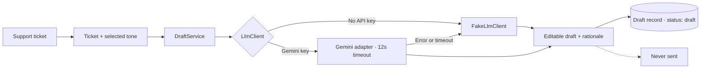

# Harbor Desk — Email Draft Studio

Harbor Desk is a small support-writing studio for turning a customer ticket into a calm, brief, or apologetic email draft. Pick one of six fictional tickets, choose a tone, generate an editable reply, and see why the draft took that approach. **It never sends email.**

Built with Laravel 13, Inertia, Vue 3, Tailwind CSS, and Pest.

## How the AI works

`DraftService` depends on the `App\Services\Llm\LlmClient` interface. The app binds a deterministic local `FakeLlmClient` when no Gemini key is configured, so the complete workflow runs offline. With `GEMINI_API_KEY`, it uses the optional Gemini adapter. Provider calls have a 12-second timeout; on a provider error or timeout, the service logs the failure and generates a local draft instead. The response also explains the tone and ticket context used.



Ticket content is passed as data to the provider prompt and is treated as untrusted input. The UI provides a human-review step; the app has no mail transport or send action.

## Run locally (no API key required)

Requirements: PHP 8.3+, Composer, Node.js 22+, npm, and the PHP SQLite extension.

```bash
git clone https://github.com/oscarmmi/email-draft-studio.git
cd email-draft-studio
composer setup
php artisan db:seed
composer dev
```

Open the URL printed by Laravel (usually `http://127.0.0.1:8000`). `composer setup` installs PHP and JavaScript dependencies, creates the local environment and application key, migrates SQLite, and builds the frontend. The seeder loads six made-up Harbor Desk tickets spanning refunds, delivery delays, how-to questions, billing, feature feedback, and unknown/general issues.

The local demo writer is deterministic and includes the selected ticket subject in its output. No account, API key, or demo credentials are needed.

### Optional Gemini provider

Add a Gemini API key to `.env` to enable the hosted provider; the key remains server-side:

```dotenv
GEMINI_API_KEY=your-key
GEMINI_MODEL=gemini-2.0-flash
```

If the provider is unavailable, drafts continue to work using the local writer.

## Tests and checks

```bash
php artisan test
composer lint:check
vendor/bin/phpstan analyse --memory-limit=512M
npm run check
npm run types:check
npm run build
```

The Pest feature tests verify that a guest can generate a calm draft and persist it with `draft` status, the subject is included in the generated text, the default no-key binding is the fake client, invalid requests are rejected, provider failures fall back to the fake, and the explanation reflects the selected tone and ticket category. Tests never call Gemini or send email.

## Architecture

- `SupportMail` stores the fictional customer message and category; `Draft` stores its tone, text, and `draft` status.
- `DraftController` validates the guest request and delegates generation to `DraftService`.
- `LlmClient` keeps provider integration replaceable. `FakeLlmClient` is deterministic; `GeminiLlmClient` is optional and bounded by a timeout.
- `DraftService` owns persistence, fallback behavior, and the concise “Why this draft” explanation.
- Inertia serves the Vue studio; draft generation returns JSON to the editor. There is no outbound mail integration.
